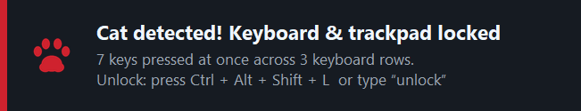
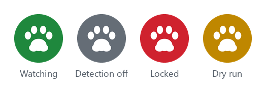
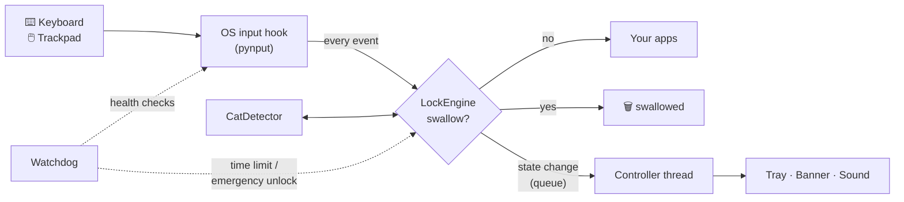

<p align="center">
  
</p>

<h1 align="center">PawLock</h1>

<p align="center">
  <b>Cat-proof your computer.</b><br>
  PawLock locks your keyboard and trackpad the moment a cat walks, sits or naps on them,<br>
  and unlocks with a hotkey that no paw will ever press by accident.
</p>

<p align="center">
  <a href="https://github.com/VinayakMokashi/pawlock/actions/workflows/ci.yml"></a>
  <a href="https://github.com/VinayakMokashi/pawlock/releases/latest"></a>
  
  
  <a href="LICENSE"></a>
</p>

<p align="center">
  
</p>

> *PawLock was written for **Snowy**, a cat who is convinced that a warm laptop is a bed,
> that the keyboard is a staircase, and that unsent emails are best finished with
> `jjjjjjjjhhhhhhgggggg`.*

---

## Contents

- [What it does](#what-it-does)
- [Install (no programming needed)](#install-no-programming-needed)
- [Using PawLock](#using-pawlock)
- [You can't lock yourself out](#you-cant-lock-yourself-out)
- [How cats are detected](#how-cats-are-detected)
- [Settings](#settings)
- [Command line](#command-line)
- [Run from source](#run-from-source)
- [Build a standalone app with PyInstaller](#build-a-standalone-app-with-pyinstaller)
- [How it works](#how-it-works)
- [Platform support](#platform-support)
- [Privacy](#privacy)
- [FAQ](#faq)
- [Project layout](#project-layout)
- [Contributing](#contributing) · [License](#license)

---

## What it does

| | Feature | Details |
|---|---|---|
| 🔒 | **Locks keyboard *and* trackpad/mouse** | Every key, click, scroll and pointer movement is swallowed before it reaches any app. |
| 🔑 | **Paw-proof hotkey** | `Ctrl + Alt + Shift + L` locks and unlocks. It is matched *exactly*, so a cat lying on those keys **plus any other key** can't trigger it. |
| ⌨️ | **Backup unlock word** | While locked, type `unlock`. Works even on laptop keyboards that can't register four keys at once. |
| 🐈 | **Automatic cat detection** | Spots paw-shaped input (many keys at once, a cat sitting down, mashing) and locks within milliseconds. Normal typing, even at 160 WPM, doesn't trigger it ([benchmarks](#how-cats-are-detected)). |
| 🟢 | **Clear feedback** | A tray icon that changes colour, an always-on-top banner, and sounds for lock/unlock. |
| 🛟 | **Six layers of safety** | Fail-open design, crash guards, watchdog, optional time limit, a `--stop` kill switch and the OS's own escape hatches. A bug can't leave you without a keyboard. |
| 🧷 | **No stuck keys** | Releases of keys you were already holding are always delivered, so Ctrl/Shift/mouse buttons never get stuck "down". |
| 🧪 | **Dry-run & practice modes** | See what *would* be locked without blocking anything, or practise unlocking in a session that releases itself after 30 s. |
| 📦 | **One-file app** | Download, double-click, done. Builds for Windows, macOS and Linux via PyInstaller. |
| 🙈 | **Private** | Never records, stores or sends what you type. No network access at all. |

<p align="center">
  
</p>

---

## Install (no programming needed)

Go to the **[latest release](https://github.com/VinayakMokashi/pawlock/releases/latest)** and download the file for your computer.

### Windows 10 / 11

1. Download **`PawLock-…-windows-x64.zip`**, right-click it and choose **Extract All**.
2. Move `PawLock.exe` somewhere permanent, for example `Documents\PawLock`.
3. Double-click **PawLock.exe**.
   *If you see "Windows protected your PC", click **More info → Run anyway**. The app isn't code-signed (signing costs money), but the source is all here.*
4. A green paw appears in the system tray (bottom-right; click **^** if it's hidden).
5. **Try it safely:** right-click the paw → **Practice lock (30 s)**, then press **Ctrl + Alt + Shift + L** to unlock.
6. Optional: right-click the paw → **Start at login**.

### macOS (Apple Silicon)

1. Download **`PawLock-…-macos-arm64.zip`**, double-click to unzip, and drag **PawLock.app** into **Applications**.
2. The first time, **right-click PawLock.app → Open → Open** (the app isn't notarised by Apple).
3. macOS will ask for permission. Open **System Settings → Privacy & Security** and switch PawLock on under **both**
   - **Accessibility**, and
   - **Input Monitoring**.
4. Quit PawLock (menu-bar paw → **Quit**) and open it again. The paw appears in the menu bar.
5. Your hotkey is **Control + Option + Shift + L**.

*Intel Macs: run from source (see below). It takes two minutes.*

### Linux (X11)

```bash
tar xzf PawLock-*-linux-x64.tar.gz
./PawLock
```

PawLock needs an **X11/Xorg session**. Wayland deliberately blocks global input hooks; see
[Troubleshooting](docs/TROUBLESHOOTING.md#linux-wayland). On GNOME, the tray icon needs the
*AppIndicator* extension.

---

## Using PawLock

### Lock and unlock

| | Windows / Linux | macOS |
|---|---|---|
| **Lock or unlock** | `Ctrl + Alt + Shift + L` | `Control + Option + Shift + L` |
| **Unlock (backup)** | type `unlock` | type `unlock` |
| **Lock from the tray** | click the paw, or right-click → **Lock now** | menu-bar paw → **Lock now** |
| **Practise safely** | tray → **Practice lock (30 s)** | same |

Press the modifiers first and `L` last, the way you'd press any shortcut. Nothing you
type while locked (including the hotkey and the unlock word) ever reaches your apps.

### What you'll see

| Locked by a cat | Locked by you | Unlocked |
|---|---|---|
|  |  |  |

You'll also hear three falling tones when PawLock locks (a short chirp first if a cat
was detected) and three rising tones when it unlocks. The tray paw turns **red** while
locked. The banner never takes keyboard focus and clicks pass straight through it.

### The tray menu

`Lock now` · `Practice lock (30 s)` · `Unlock` · `Detect cats automatically ✓` · `Sound effects ✓` ·
`Start at login` · `Edit settings…` · `Reload settings` · `Open log folder` · `Quit PawLock`

---

## You can't lock yourself out

A program that blocks your keyboard has to be trustworthy, so PawLock stacks several
independent safety nets ([details](docs/SAFETY.md)):

| # | Layer | What it protects against |
|---|---|---|
| 1 | **Fail-open engine.** Any internal error lets the event through *and* releases the lock. | Bugs |
| 2 | **Crash guards** on every thread release the lock on unhandled exceptions. | Bugs in the tray, banner, sound… |
| 3 | **Signal handlers.** Ctrl+C, `kill`, logoff and `pawlock --stop` unlock and exit cleanly. | Being told to quit |
| 4 | **Watchdog thread** checks every second that the hooks are alive (re-installs them), the controller isn't frozen, and the optional `max_lock_minutes` hasn't passed. | Hangs, dead hooks |
| 5 | **Hard exit.** If releasing the hooks itself hangs, PawLock terminates itself. The OS removes every hook of a dead process. | The impossible |
| 6 | **The operating system.** Windows/macOS automatically drop hooks that stop responding, and some keys can never be blocked. | Everything else |

**Emergency exits, if you ever need them:**

- **Windows:** `Ctrl + Alt + Del` can never be blocked. Choose *Task Manager*, select *PawLock* and click **End task**.
- **macOS:** from another device, `ssh you@your-mac pawlock --stop`, or set `max_lock_minutes`. Worst case, hold the power button.
- **Linux:** `Ctrl + Alt + F3` (switch to a text console), log in, run `pkill -f -i pawlock`, then `Ctrl + Alt + F2`/`F7` to go back.
- **Anywhere:** `PawLock --stop` (or `python -m pawlock --stop`) from a terminal or a desktop shortcut.

---

## How cats are detected

Cats don't type. They press *many neighbouring keys at once* (a paw is about 4 cm wide),
*hold* them (sitting, sleeping), and produce keystrokes with *no words, no spaces and no
vowels*. PawLock looks at **how** keys are pressed, never at what you're typing.

| Rule | Fires when… | Typical cat |
|---|---|---|
| **Paw chord** | 5+ keys are held at once across 2+ keyboard rows | standing on the keyboard |
| **Sitting** | 3+ keys held for 1.5 s | sitting / lying down |
| **Long hold** | one typing key held for 20 s | a paw parked on "k" |
| **Mashing** | in the last 12 presses there's *paw contact* (keys landing within 35 ms) **plus** 2 of: no spaces, no vowels, clustered keys, faster than fast typing | walking across |
| **Click storm** *(off by default)* | 12+ clicks within 2 s | kneading the trackpad |

Measured with the reproducible simulator in [`pawlock/simulate.py`](pawlock/simulate.py)
(`python scripts/detector_benchmark.py --runs 50`):

| False locks while a person types | low | **medium** (default) | high |
|---|---|---|---|
| 40 / 70 / 100 WPM | 0% | **0%** | 0% |
| 130 WPM with long key holds | 0% | **0%** | 0% |
| 160 WPM with long key holds | 0% | **0%** | 8% |
| fast password, vim `hjkl`, card number | never | **never** | never |

| Cats caught | low | **medium** | high |
|---|---|---|---|
| walks 4 steps across the keys | 18% | **56%** | 92% |
| walks 6 steps | 60% | **98%** | 100% |
| sits or lies down on the keyboard | 100% | **100%** | 100% |
| parks one paw on a key for 30 s | no | **yes** | yes |

A cat can type a few characters before it's caught, but no more. Tune with
`"sensitivity": "low" | "medium" | "high"`, or run `pawlock --dry-run` to watch what
*would* trigger without blocking anything. Everything is explained in
[docs/AUTO_DETECTION.md](docs/AUTO_DETECTION.md).

> 🎮 **Gamers:** holding W+A+Shift for ages is fine, but holding three letter keys at once
> for 1.5 s looks a lot like a cat. Untick **Detect cats automatically** in the tray while
> you play, or use `"sensitivity": "low"`.

---

## Settings

Right-click the paw → **Edit settings…** opens `config.json` in your text editor. Save it,
then choose **Reload settings**.

| Setting | Default | What it does |
|---|---|---|
| `hotkey` | `"ctrl+alt+shift+l"` | Lock/unlock combination. Use 2+ modifiers and one ordinary key. |
| `unlock_phrase` | `"unlock"` | Word that unlocks while locked (4-32 letters/digits; `""` disables). |
| `lock_mouse` | `true` | Also block mouse/trackpad. `false` = keyboard-only lock. |
| `auto_detect` | `true` | Lock automatically when a cat is detected. |
| `sensitivity` | `"medium"` | `low`, `medium` or `high` (see above). |
| `max_lock_minutes` | `0` | Auto-unlock after this many minutes (`0` = never). |
| `start_locked` | `false` | Lock as soon as PawLock starts. |
| `tray` / `overlay` / `sound` / `notifications` | `true` | Feedback channels (the banner is off by default on macOS). |
| `overlay_position` | `"top"` | `top`, `bottom` or `center`. |

All settings, plus advanced detector tuning, are in [docs/CONFIGURATION.md](docs/CONFIGURATION.md).

Where the file lives: Windows `%APPDATA%\PawLock\config.json` · macOS
`~/Library/Application Support/PawLock/config.json` · Linux `~/.config/pawlock/config.json`
(`pawlock --where` prints it).

---

## Command line

```text
pawlock                       start protecting (tray icon appears)
pawlock --practice [SECONDS]  start locked; auto-unlocks after 30 s (or SECONDS)
pawlock --dry-run             detect and report, never block anything
pawlock --lock                start locked
pawlock --sensitivity high    override the detector sensitivity for this run
pawlock --max-lock-minutes 60 auto-unlock after an hour
pawlock --no-auto-detect      hotkey only
pawlock --no-tray --no-overlay --no-sound
pawlock --stop                kill switch: stop the running PawLock
pawlock --status              is it running?
pawlock --doctor              health check (hooks, permissions, tray, banner…)
pawlock --where               where settings and logs live
pawlock --reset-config        restore defaults (keeps a backup)
```

With the packaged app use `PawLock.exe --stop` etc. Without a console, results are shown
in a dialog or a text file. **Tip:** make a desktop shortcut to `PawLock.exe --stop` as a
one-click emergency button.

---

## Run from source

Requires Python 3.9+.

```bash
git clone https://github.com/VinayakMokashi/pawlock.git
cd pawlock
python -m venv .venv
.venv\Scripts\activate          # Windows
source .venv/bin/activate       # macOS / Linux
pip install -r requirements.txt
python -m pawlock --doctor      # check everything works
python -m pawlock --practice    # try it: locked for 30 s, unlock with the hotkey
python -m pawlock               # for real
```

On Debian/Ubuntu also install Tk for the banner: `sudo apt install python3-tk`.
On macOS, give your **Terminal** the Accessibility and Input Monitoring permissions.

---

## Build a standalone app with PyInstaller

```bash
pip install -r requirements-dev.txt
python scripts/build.py --archive
```

| OS | Result |
|---|---|
| Windows | `dist/PawLock.exe` (one file, no console window) + `dist/PawLock-<ver>-windows-x64.zip` |
| macOS | `dist/PawLock.app` (menu-bar app, no Dock icon) + `.zip` |
| Linux | `dist/PawLock` (one file) + `.tar.gz` |

PyInstaller can't cross-compile, so build on each OS, or push a `v*` tag and let the
[release workflow](.github/workflows/release.yml) build all three and attach them to a
GitHub Release. Code signing, antivirus false positives, shortcuts and installers are
covered in **[docs/PACKAGING.md](docs/PACKAGING.md)**.

---

## How it works



- **Windows:** low-level keyboard/mouse hooks (`WH_KEYBOARD_LL`, `WH_MOUSE_LL`). Events are dropped one at a time in pynput's `win32_event_filter`.
- **macOS:** Quartz event taps. Events are dropped one at a time in `darwin_intercept`.
- **Linux/X11:** passive listeners while unlocked; an exclusive keyboard/pointer grab while locked.

The hotkey and the unlock word are checked **inside the hook, before** the decision to
swallow. That's how they "bypass" the lock without ever reaching your apps. A release is
swallowed only if its press was, so held keys never get stuck. Full write-up, with sequence
diagrams and the threading model: **[docs/HOW_IT_WORKS.md](docs/HOW_IT_WORKS.md)**.

---

## Platform support

| | Windows 10/11 | macOS 12+ | Linux X11 | Linux Wayland |
|---|---|---|---|---|
| Keyboard lock | ✅ | ✅ | ✅ | ❌ *([why](docs/TROUBLESHOOTING.md#linux-wayland))* |
| Mouse / trackpad lock | ✅ | ✅ (pinch/swipe *gestures* aren't blocked) | ✅ | ❌ |
| Per-event blocking, no stuck keys | ✅ | ✅ | via device grab | – |
| Tray icon | ✅ | ✅ menu bar | ✅ (AppIndicator on GNOME) | – |
| On-screen banner | ✅ | opt-in | ✅ | – |
| Hand-tested on real hardware | ✅ Windows 11 | CI + unit tests | CI + unit tests | – |

Known limits: `Ctrl + Alt + Del` and `Win + L` can't be blocked on Windows (by design).
If an *administrator* window is focused, run PawLock as administrator too, or Windows
won't let it see that window's input.

---

## Privacy

- PawLock **never stores, logs or transmits keystrokes.** The detector keeps the last few
  seconds of key *positions* in memory to judge their shape, then forgets them.
- The log contains only state changes ("locked: 6 keys pressed at once…") and errors.
- No network code, no telemetry, no auto-updates. Read the source, it's short.

---

## FAQ

**Will it interfere with my games / Discord push-to-talk?**
Holding one key is fine for 20 s (medium) and arrow/editing keys are exempt. If a game
needs three letter keys held at once, untick *Detect cats automatically* while you play.

**A few letters got through before it locked. Why?**
Detection needs evidence. A paw chord is caught on the 5th key; a walking cat after a few
steps. Anything typed *after* detection is blocked.

**My laptop keyboard won't register Ctrl+Alt+Shift+L.**
Some keyboards can't detect four keys at once ("ghosting"). Type `unlock` instead, or pick
another `hotkey` such as `ctrl+alt+k`.

**Does it stop someone else from using my computer?**
No. It's a cat lock, not a security lock: anyone who knows the hotkey can unlock it. Use
your OS's screen lock (`Win + L`, `Ctrl + Cmd + Q`) for that.

**Antivirus flagged PawLock.exe!**
Global keyboard hooks plus a PyInstaller bundle look suspicious to some heuristics. It's a
false positive; see [docs/PACKAGING.md](docs/PACKAGING.md#antivirus-false-positives).

More in **[docs/TROUBLESHOOTING.md](docs/TROUBLESHOOTING.md)**.

---

## Project layout

```text
pawlock/
├── pawlock/
│   ├── __main__.py        python -m pawlock  /  PyInstaller entry point
│   ├── cli.py             command-line flags and tools (--stop, --doctor, ...)
│   ├── app.py             wires everything together; owns the threads
│   ├── engine.py          lock state machine: decides the fate of every event
│   ├── detector.py        cat-detection heuristics
│   ├── hotkey.py          exact-match hotkey + unlock phrase
│   ├── keys.py            one key vocabulary for all OSes + keyboard geometry
│   ├── backends/          windows.py · macos.py · swap.py (Linux) on top of pynput
│   ├── feedback/          tray.py · overlay.py · sound.py · icons.py
│   ├── safety.py          watchdog, crash guards, signal handlers
│   ├── instance.py        single instance + the --stop kill switch
│   ├── autostart.py       "Start at login" for Windows/macOS/Linux
│   ├── config.py          self-healing JSON settings
│   ├── doctor.py          --doctor health check
│   └── simulate.py        synthetic humans and cats for tests and benchmarks
├── tests/                 260+ tests, no real input devices needed
├── scripts/               build.py · make_icons.py · detector_benchmark.py · capture_screenshots.py
├── docs/                  how it works, detection, safety, configuration, packaging, troubleshooting
├── assets/                app icons (generated by scripts/make_icons.py)
├── pawlock.spec           PyInstaller recipe
└── .github/workflows/     CI (3 OSes) and release builds
```

---

## Contributing

Bug reports, cat videos and pull requests are welcome; see [CONTRIBUTING.md](CONTRIBUTING.md).
Please attach the output of `pawlock --doctor` to bug reports.

```bash
pip install -r requirements-dev.txt
pytest          # 260+ tests, run anywhere (no keyboard hooks are installed)
ruff check .
```

## License

[MIT](LICENSE). Use it, change it, share it with every cat owner you know.
