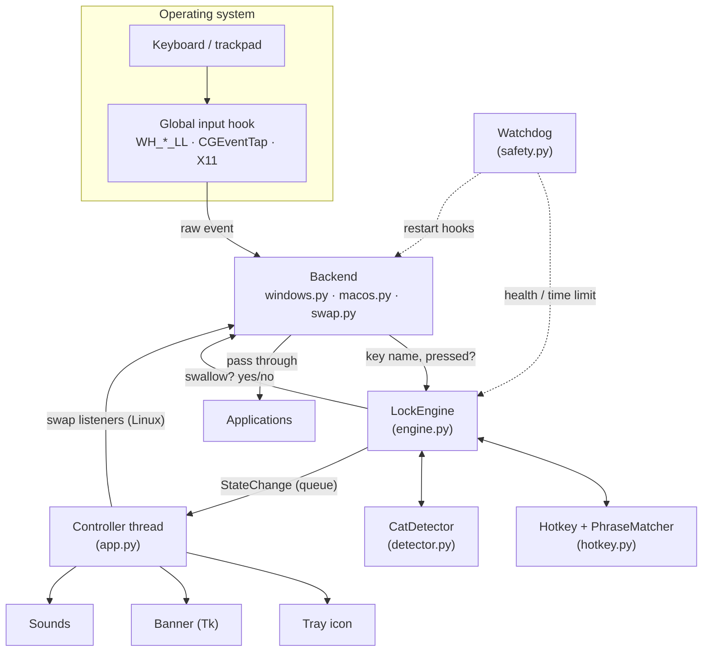
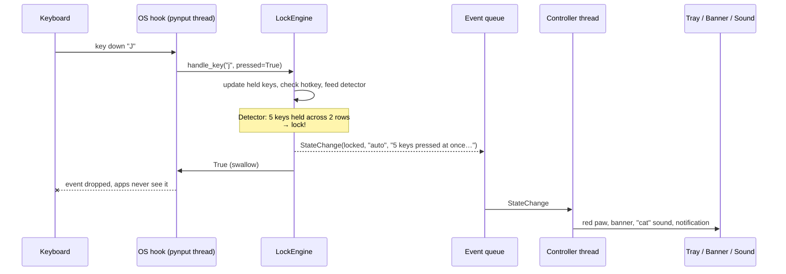

# How PawLock works

This document is for people who want to understand, audit or extend PawLock.
It covers the event path, the lock state machine, the three platform backends,
the threading model and why some of the design choices were made.

- [The big picture](#the-big-picture)
- [The event path](#the-event-path)
- [The lock engine](#the-lock-engine)
- [Balanced suppression: why keys never get stuck](#balanced-suppression-why-keys-never-get-stuck)
- [How the hotkey bypasses the lock](#how-the-hotkey-bypasses-the-lock)
- [Platform backends](#platform-backends)
- [Threads](#threads)
- [Feedback](#feedback)
- [Testing without a keyboard](#testing-without-a-keyboard)

---

## The big picture

Three ideas carry the whole design:

1. **One decision point.** Every input event from every platform ends up as a call to
   `LockEngine.handle_key()` / `handle_mouse_*()`, which returns *swallow* or *pass*.
2. **The hook path is tiny and never blocks.** Anything slow (sounds, UI, swapping
   listeners) happens on other threads, reached through a queue.
3. **Fail open.** Every error path ends with the input flowing again.

## The event path

Everything left of the queue runs inside the OS hook and takes microseconds.

## The lock engine

`pawlock/engine.py` holds all state under one re-entrant mutex:

| State | Purpose |
|---|---|
| `_locked`, `_locked_since` | Are we locked, and since when (for `max_lock_minutes`) |
| `_held` | Keys currently down → last time we heard from them (for exact hotkey matching and stale-key expiry) |
| `_key_delivered` / `_button_delivered` | Did the *press* of this key/button reach the OS? (balanced suppression) |
| `_cooldown_until` | Ignore the detector briefly after an unlock |

Decision order for a **fresh key press**:

1. **Hotkey?** If the held set is *exactly* the hotkey and this key completes it → toggle the lock, swallow.
2. **Locked?** Feed the unlock phrase matcher (unlock if complete), swallow.
3. **Detector says cat?** Lock, swallow.
4. Otherwise, pass.

**Auto-repeat** presses (a key already in `_held`) follow the fate of the original press.
**Releases** follow the rule below.

Two escape hatches skip the mutex entirely, so they work even if a thread holding it is
stuck: `handle_mouse_motion()` (the hottest path, reading two attributes) and
`force_unlock()` (an atomic store used by the watchdog and crash handlers).

## Balanced suppression: why keys never get stuck

Operating systems track which keys are down. If a key's *press* reaches the OS but its
*release* is swallowed, the OS thinks the key is still held: Ctrl stays stuck, or a mouse
drag never ends. PawLock therefore swallows a release **only if it swallowed the matching
press**:

| Press happened… | Press | Release happens… | Release |
|---|---|---|---|
| unlocked | delivered | while locked | **delivered** (no stuck key) |
| locked | swallowed | after unlock | **swallowed** (no orphan key-up) |
| before PawLock started | – | any time | delivered (a stray key-up is harmless) |

The same table applies to mouse buttons. This is also why, after locking with
`Ctrl + Alt + Shift + L`, your apps see the modifiers go down and up again but never
see the `L`.

## How the hotkey bypasses the lock

The hotkey is not a separate OS-level hotkey registration: it's checked *inside* the hook,
before the swallow decision. So:

- while locked, the hotkey keys are still seen by PawLock (and swallowed from apps);
- the match is **exact**: `held == {ctrl, alt, shift, l}` and `L` was the key just pressed;
- a cat lying across the keyboard holds a *superset* (`{ctrl, alt, shift, l, space, …}`),
  which never matches. Modifiers pressed *after* `L` don't match either.

The unlock phrase works the same way: a rolling buffer of the last N letter/digit presses,
compared with the phrase. Any non-character key (space, Enter, arrows) resets it.

## Platform backends

All three are thin translators from OS events to engine calls. pynput is only imported
when a backend starts, which keeps the rest of the code importable (and testable)
anywhere.

### Windows: `backends/windows.py`

- pynput installs `WH_KEYBOARD_LL` and `WH_MOUSE_LL` hooks.
- We pass `win32_event_filter`, which pynput calls with the raw message and
  `KBDLLHOOKSTRUCT`/`MSLLHOOKSTRUCT` **before anything else**.
- Swallow = `listener.suppress_event()`: pynput raises an internal exception that makes
  the hook procedure return 1, so Windows drops the event. Pass = return `False`, so the
  event continues *and* pynput skips its own (unneeded) callbacks.
- Events flagged `LLKHF_INJECTED` / `LLMHF_INJECTED` (on-screen keyboards, remote desktop,
  automation) are never touched.
- Windows removes LL hooks that don't answer within `LowLevelHooksTimeout`, and all hooks
  of a process that exits.

### macOS: `backends/macos.py`

- pynput creates active `CGEventTap`s when given `darwin_intercept`.
- Our intercept reads the key code (`kCGKeyboardEventKeycode`) and, for modifier keys
  (`kCGEventFlagsChanged`), works out press vs release from the event flags and our own
  held-key state.
- Swallow = return `None`; pass = return the event.
- If macOS disables a slow tap (`kCGEventTapDisabledByTimeout`) we mark the backend
  unhealthy and the watchdog re-installs it.
- Key codes are positional (US ANSI layout), so on macOS the hotkey letter is matched by
  physical position.

### Linux/X11: `backends/swap.py`

X11 can't drop single events from a passive listener, but pynput's `suppress=True` grabs
the entire keyboard/pointer. So:

- **unlocked:** passive listeners feed the engine (hotkey + detector);
- **locked:** the controller thread swaps them for grabbing listeners, whose callbacks
  still feed the engine, so the hotkey and phrase keep working;
- X11 releases grabs when the client disconnects, so a crash frees the input.

The swap happens on the controller thread (never inside a callback) under a lock; the
watchdog's health check takes the same lock, so it never sees a half-swapped state.

## Threads

| Thread | Owner | Does | Must never… |
|---|---|---|---|
| `MainThread` | `app._run_ui` | Tk banner loop (or macOS tray, or a wait loop); runs signal handlers | block |
| `keyboard-hook`, `mouse-hook` | pynput | call the engine for every event | do I/O or wait |
| `controller` | `app._controller_loop` | apply `StateChange`s: logging, feedback, listener swap; `engine.tick()` 4×/s; heartbeat | die (loop catches everything) |
| `watchdog` | `safety.Watchdog` | time limit, heartbeat check, hook health, restarts | depend on other threads |
| `tray` | pystray | tray icon + menu (Windows/Linux) | crash the app (actions are wrapped) |
| `sound` (short-lived) | `SoundPlayer` | play one cue | — |

Tk is not thread-safe: only the main thread touches it; others post commands to the
banner's queue, polled every 100 ms. On macOS AppKit also wants the main thread, so the
tray uses `run_detached()` and shares Tk's run loop.

## Feedback

`feedback/__init__.py` turns a `StateChange` into:

- **Tray** (`tray.py`, pystray): icon colour (green / grey / red / amber), tooltip, menu.
- **Banner** (`overlay.py`, Tk): borderless, always on top, DPI-scaled. On Windows it's
  made click-through and non-activating with `WS_EX_TRANSPARENT | WS_EX_NOACTIVATE`, and
  shown/hidden by changing opacity, so it can never steal focus.
- **Sound** (`sound.py`): `winsound.Beep` tone patterns on Windows, system sounds via
  `afplay` on macOS, freedesktop sounds via `paplay`/`canberra-gtk-play` on Linux.
- **Notifications** via pystray, only for cat detections and safety unlocks.

Icons are drawn in code (`icons.py`) with Pillow, so no image files are needed at runtime.

## Testing without a keyboard

Everything above the backends is pure Python with injectable clocks, so the test suite
(`tests/`) runs headless on any OS:

- `simulate.py` generates realistic **human typing** (configurable WPM, key-hold times,
  Shift for capitals) and **cats** (walking clusters of neighbouring keys, sitting with OS
  auto-repeat, a paw parked on one key).
- The Windows and macOS backends are tested by calling their filters/intercepts with
  fake OS structures and a fake pynput listener.
- The watchdog is driven step by step with a fake clock and a fake backend.

A live check on Windows 11 additionally verified, against the real low-level hooks, that
locked keys are swallowed, the hotkey bypasses the lock without leaking, and pre-lock
keys get their releases delivered.
